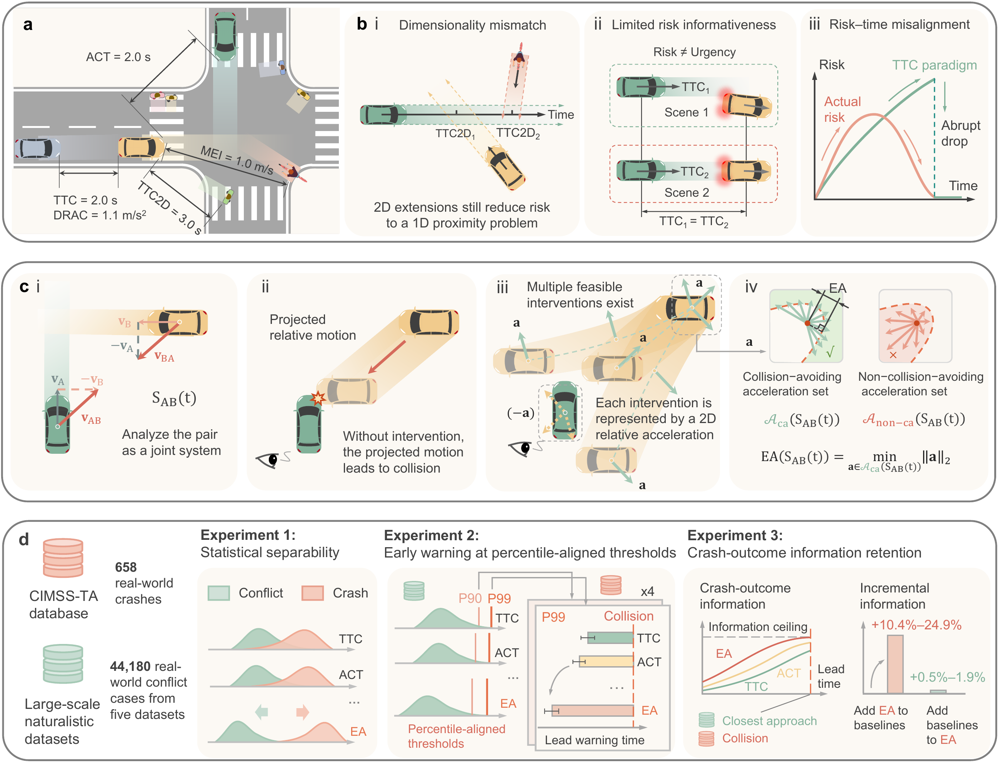
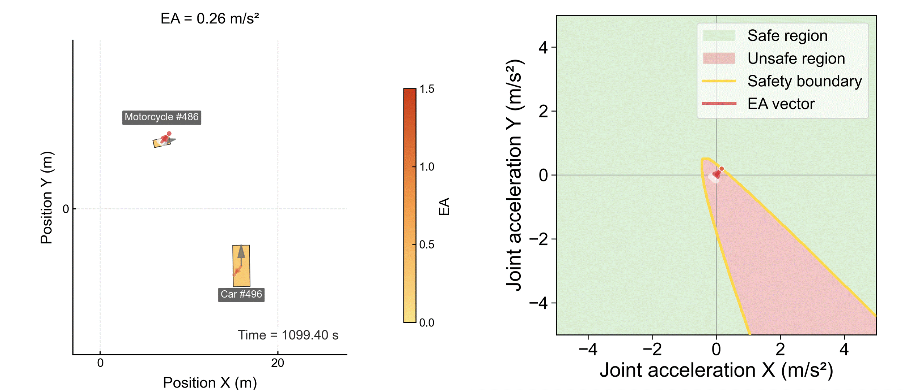
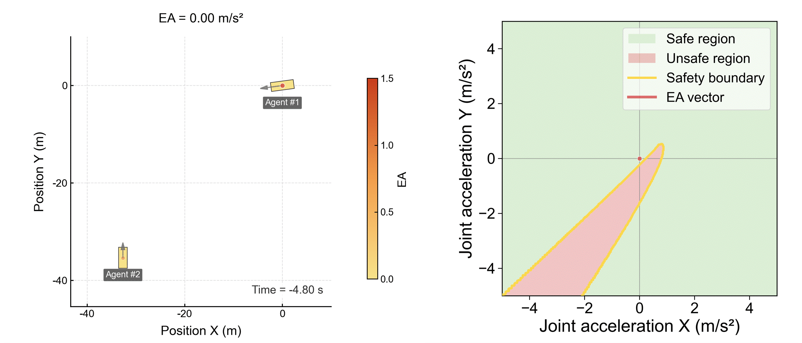

# Evasive Acceleration (EA)

Evasive Acceleration (EA) quantifies driving risk by measuring the difficulty
of collision avoidance. Intuitively, EA finds the smallest two-dimensional
relative acceleration needed to change the projected motion and avoid collision.

EA captures two-dimensional interaction risk. Evaluated on 44,180 naturalistic
interactions from five datasets and 658 reconstructed crashes, it showed stronger
overall crash–noncrash discrimination than TTC and other primary baselines.

Use EA to analyze traffic conflicts, identify high-risk scenarios, and evaluate
automated-driving safety.

Paper: [Driving risk emerges from the required two-dimensional joint evasive acceleration](https://arxiv.org/abs/2604.17841).

[Install and run](#install-and-run) · [Recomputable examples](#recomputable-examples) · [Python usage](#python-usage) · [Input conventions](#input-conventions) · [Measure runtime](#measure-runtime)

One EA implementation serves the Python API, command line, and notebooks.
Provide yaw rates directly, or estimate missing values from current and past
headings. See [installation](#install-and-run) to prepare the native component
once before use.

## Visual overview

### Paper Fig. 1: the EA framework

<p align="center">
  <a href="assets/figures/ea_framework_fig1.pdf">
    
  </a>
</p>

Figure 1 from the paper brings together the limitations of time-based risk
measures, the minimum two-dimensional relative acceleration required for
collision avoidance, and the experimental validation.
[Open the vector PDF](assets/figures/ea_framework_fig1.pdf) for a closer look.

## Visual examples

### Naturalistic interaction

<p align="center">
  
</p>

A vehicle–motorcycle intersection interaction from the SinD dataset. The
magnitude of the red arrow represents EA; a longer arrow denotes greater
required evasive acceleration.

### Reconstructed crash

<p align="center">
  
</p>

A reconstructed T-bone crash from CIMSS-TA, using the same red-arrow encoding.

## Recomputable examples

Start with the question you want to answer:

| Goal | Entry point | What you get |
|---|---|---|
| Understand what EA adds to TTC | [Equal-TTC comparison](docs/comparison_case.md) | Two synthetic states, full inputs, actual EA/TTC/DRAC results, a figure, and settings. |
| Use a tracking table with your own column names | [Bring your own data](docs/bring_your_own_data.md) | A copyable DataFrame adapter with explicit units, coordinate conversion, and causal yaw-rate handling. |
| Explore interactively | [EA quickstart notebook](notebooks/ea_quickstart.ipynb) | Recompute the comparison, convert custom data, inspect risk/yaw-rate histories, and adjust two manual controls. |
| Check computation speed on your machine | [Runtime benchmark](docs/runtime.md) | Warmed four-pairing timing, every observation, and recorded inputs, settings, and environment. |

After installing the visualization extras, reproduce the comparison with:

```bash
python examples/comparison_case.py --output-dir outputs/comparison_case
```

Both cases have TTC = 2.00 s, while EA is approximately
0.500 and 0.886 m/s². These are explicitly synthetic illustrations, not paper
experiment data or evidence for a universal safety threshold. EA permits
two-dimensional relative avoidance, not only lane-constrained braking.

New figures use [Fig. 1's palette and regular Arial](docs/figure_style.md), with
no bold labels. Arial must be available for final exports; an explicitly
enabled, warned font fallback is only for previews or hosted CI.

## Interactive notebook

From a source checkout:

```bash
python -m pip install -e ".[notebook]"
python -m evasive_acceleration.native_build
python -m notebook notebooks/ea_quickstart.ipynb
```

Run the cells in order. Each execution writes a fresh run directory, without
replacing inputs or earlier runs. The notebook uses the same API and example
scripts, not a second implementation of EA. See the [notebook guide](notebooks/README.md)
for font setup, hosted notebook use after publication, and headless execution.

## Install and run

From a source checkout, with Python 3.10 or newer:

```bash
git clone https://github.com/AutoChengh/evasive-acceleration.git
cd evasive-acceleration
python -m pip install -e ".[batch,viz]"
python -m evasive_acceleration.native_build
ea single
ea batch --input examples/data/without_yaw_rate.csv
```

The single-frame example prints approximately `EA = 4.911 m/s^2`. The batch
command automatically estimates missing yaw rates. Open:

```text
outputs/batch_results/auto/without_yaw_rate_EA.csv
outputs/batch_results/auto/without_yaw_rate_EA.run.json
```

The CSV contains frame-wise EA, yaw-rate provenance, and error diagnostics.
The JSON records the input, settings, and run summary. Existing result files
are protected; rerun with `--overwrite` to replace them.

For computation only, `python -m pip install -e .` installs the minimal package.
The optional `batch` and `viz` extras add CSV processing and plotting.
Numba is included in the base installation; its first call can include JIT
compilation time. `python -m evasive_acceleration` accepts the same commands as `ea`.
The `notebook` extra includes the interactive notebook and execution dependencies;
it is not required for ordinary EA computation.

The one-time native build requires a GCC-compatible C++17 compiler (`g++`,
or MinGW-w64 `g++` on Windows). It does not install a compiler and is never
launched automatically by an EA call. Missing dependencies fail explicitly.
See the [setup and runtime guide](docs/runtime.md#prepare-the-native-component)
for compiler selection and custom build paths. Source installation is shown
here; this update does not imply a PyPI release.

## Three ready-to-run inputs

These small examples describe the same two approaching vehicles at 10 Hz.
They vary only in yaw-rate availability. Run the commands from the checkout
root after installation:

| Input | Command | Yaw-rate handling |
|---|---|---|
| [Provided values](examples/data/provided.csv) | `ea batch --input examples/data/provided.csv --yaw-rate-source provided` | Use both input columns. |
| [No yaw-rate columns](examples/data/without_yaw_rate.csv) | `ea batch --input examples/data/without_yaw_rate.csv` | Estimate both streams causally. |
| [Partially missing values](examples/data/mixed_yaw_rate.csv) | `ea batch --input examples/data/mixed_yaw_rate.csv` | Use finite provided values; estimate individual missing values. |

Default outputs are separated by policy under `outputs/batch_results/`:
`provided/`, `estimated/`, or `auto/`, relative to your current working
directory. To compare policies on the same input in fresh output folders:

```bash
ea batch --input examples/data/provided.csv --yaw-rate-source provided --output-dir outputs/comparison/provided
ea batch --input examples/data/provided.csv --yaw-rate-source estimated --output-dir outputs/comparison/estimated
```

The first row estimated from heading alone uses a zero initialization
placeholder. Its diagnostics distinguish that placeholder from an initialized
zero-turn estimate. Consequently, the two policies need not have identical EA
on that row, even with otherwise identical data.

## Python usage

After installation, imports work from any working directory. The complete
scripts [provided_state.py](examples/provided_state.py) and
[from_history.py](examples/from_history.py) can also be copied into your project.

### Yaw rate is available

```python
import math
from evasive_acceleration import RoadUserState, compute_ea

agent_a = RoadUserState(
    x=0.0, y=0.0, speed=10.0, heading=0.0,
    length=4.5, width=1.8, yaw_rate=0.0,
)
agent_b = RoadUserState(
    x=20.0, y=0.0, speed=8.0, heading=math.pi,
    length=4.7, width=1.9, yaw_rate=0.0,
)
ea = compute_ea(agent_a, agent_b)
print(f"EA = {ea:.3f} m/s^2")  # Approximately 4.911 m/s².
```

### Yaw rate is unavailable

Use `RoadUserKinematicState` with six fields and attach the estimate from each
object's own history:

```python
from evasive_acceleration import (
    RoadUserKinematicState,
    build_state_with_estimated_yaw_rate,
    compute_ea,
)

current = RoadUserKinematicState(
    x=0.0, y=0.0, speed=10.0, heading=0.02,
    length=4.5, width=1.8,
)
state, estimate = build_state_with_estimated_yaw_rate(
    current,
    times_s=[0.0, 0.1, 0.2],
    headings_rad=[0.0, 0.01, 0.02],
)
print(state.yaw_rate, estimate.initialized)  # 0.1, True
```

Repeat this for the other road user, then call `compute_ea(state_a, state_b)`.
Both histories must end at the current decision time. The last history heading
must match the corresponding current state. For continuous online use, keep
one `CausalYawRateEWMA` instance per object; see the
[yaw-rate method and API](docs/causal_yaw_rate.md).

Both yaw-rate paths call the same EA solver; there is no backend selection.

## Input conventions

All inputs for an interaction must use the same Cartesian coordinate frame.
Positions describe the centers of the oriented bounding boxes; heading is
measured counterclockwise from the positive x axis. Positive yaw rate increases
heading. Convert clockwise headings, image coordinates with downward-positive
y, degrees, and rear-axle positions before calling the solver.

| State field | Meaning | Unit |
|---|---|---|
| `x`, `y` | Bounding-box center position | m |
| `speed` | Speed magnitude along heading | m/s |
| `heading` | Body heading | rad |
| `length`, `width` | Positive body dimensions | m |
| `yaw_rate` | Signed heading rotation rate | rad/s |

Use appropriate body dimensions for vehicles, cyclists, and pedestrians.
The heading of a box and the direction of its displacement can differ,
especially at low speed; the estimator uses the headings you supply.

### Batch CSV schema

Each file must describe **one continuous interaction pair in increasing time
order**. Keep observations in their original causal order; do not interleave
different pairs. If `Vehicle Number` or `2_Vehicle Number` changes, the
corresponding estimator resets.

| Agent A column | Agent B column | Unit |
|---|---|---|
| `Position X (m)` | `2_Position X (m)` | m |
| `Position Y (m)` | `2_Position Y (m)` | m |
| `Velocity (m/s)` | `2_Velocity (m/s)` | m/s |
| `Heading` | `2_Heading` | rad |
| `Length (m)` | `2_Length (m)` | m |
| `Width (m)` | `2_Width (m)` | m |

The default yaw-rate policy is `auto`:

| Policy | Extra input | Behavior |
|---|---|---|
| `provided` | `Yawrate`, `2_Yawrate`, both finite | Use the input yaw rates. Timestamps are not needed for EA. |
| `estimated` | `Time (s)` | Estimate both yaw-rate streams; ignore provided values. |
| `auto` | Yaw-rate columns when available; `Time (s)` if any value needs estimation | Prefer each finite supplied value, otherwise estimate it. |

In `auto`, timestamps are only required when estimation is actually needed.
When timestamps are available, estimator histories are maintained on provided
rows too, so a later missing yaw rate can use earlier headings. Additional
input columns are preserved. Baseline metric errors are reported separately
from EA.

The causal estimator wraps heading differences to `[-π, π)`, divides by the
actual elapsed time, and applies a rate EWMA. Defaults are `tau = 0.6 s`,
output deadband `0.002 rad/s`, and four output decimals. The internal state
keeps full precision. These preprocessing settings and initialization behavior
are documented in [docs/causal_yaw_rate.md](docs/causal_yaw_rate.md).

Both supplied and estimated yaw rates feed the same numerical EA core.
Use the corresponding supplied yaw rates when reproducing an input experiment;
re-estimating them changes the inputs. Historical paper reproduction is
documented in the [source archive guide](docs/history.md).

## Command-line reference

```bash
ea single --help
ea batch --help
ea benchmark --help
ea batch --input path/to/case.csv
ea batch --input-dir path/to/csvs --yaw-rate-source estimated
ea batch --input path/to/case.csv --output-dir path/to/results
```

`--input` and `--input-dir` are alternatives. A custom `--output-dir` receives
files directly, without a policy subdirectory; use separate directories when
comparing policies. Files ending in `_EA.csv` are skipped during directory
discovery to avoid processing generated results again. The CLI reports file
and row failures and returns a nonzero exit code if a run has errors. An
input file cannot be replaced by an output, including with `--overwrite`.

The original source entry points remain available:

```bash
python src/single_frame.py
python src/batch_compute.py --input examples/data/without_yaw_rate.csv
```

Running batch without an input uses the source checkout's `demo_data/` when
present. `demo_data/`, `examples/`, and `visualization/` are checkout resources;
code installed from a wheel should be given explicit external input paths.

## Reading the results

| Output | Meaning |
|---|---|
| `EA_CVCV`, `EA_CVCT`, `EA_CTCV`, `EA_CTCT` | EA for the four nominal motion combinations, in m/s²; `CT` denotes CTRV |
| `EA` | Arithmetic mean of the four unrounded mode-specific magnitudes, in m/s² |
| `EA_Yawrate_A_used_rad_s`, `EA_Yawrate_B_used_rad_s` | Actual yaw rates used by the solver |
| `EA_Yawrate_A_source`, `EA_Yawrate_B_source` | Provided, estimated, initialization, or error provenance |
| `EA_Yawrate_A_initialized`, `EA_Yawrate_B_initialized` | Estimated: a backward difference was available; provided: the supplied value was finite |
| `EA_Yawrate_A_samples`, `EA_Yawrate_B_samples` | Valid causal observations in the estimator |
| `EA_Yawrate_A_error`, `EA_Yawrate_B_error` | Specific yaw-rate input or estimation errors |
| `EA_status`, `EA_error` | EA computation status and failure detail |
| `EA_baseline_error` | Separate error detail for optional baseline calculations |

`EA = 0` means no added relative acceleration is required over the evaluated
motion models and finite horizon. `inf` is the solver's result for current
body contact or no feasible acceleration within the configured search.
`NaN` indicates an unavailable or invalid computation; inspect status and error
columns. A first estimated yaw rate of `0` is an initialization placeholder,
not an observed zero derivative. The Python API retains full numerical precision;
batch CSVs round the EA columns to four decimal places, as in the paper pipeline.

Provided rows report a sample count of zero because no heading-history
estimate was used for that row. Read initialization and sample count together
with the source column.

Batch output also includes baseline quantities such as `DRAC`, `TTC`, `TAdv`,
`ACT`, `EI`, `MEI`, and `TTC2D`. Their definitions and normalization rules are
in `src/baseline_risk_metrics.py`. For example, a non-conflicting TTC can be
`inf`, which has a different meaning from an unbounded EA search result.
The unchanged historical baseline also maps some undefined/current-overlap
states to `0` or `inf`; do not interpret these values alone as a safe label.
The new comparison avoids initially overlapping boxes.

## What EA computes

Two nominal motion models are used for each road user:

- **CV:** constant speed and heading.
- **CTRV:** constant speed and yaw rate; called `CT` in the compatible output
  column names.

The four ordered pairings are CV–CV, CV–CTRV, CTRV–CV, and CTRV–CTRV. For each,
EA is the minimum magnitude of a constant two-dimensional relative acceleration
that avoids predicted body contact. The final score is the arithmetic mean of
these four scalar magnitudes, not a mean of acceleration vectors.

All four pairings use continuous-time collision verification over the finite
prediction horizon and a global search in two-dimensional acceleration space.
With the default tolerance, a finite result is accepted only after conservative
body-contact verification and an upper/lower objective gap of at most
0.001 m/s² per pairing. The same computation serves supplied and causally
estimated yaw rates.

| Setting | Default |
|---|---:|
| Prediction horizon `T_total` | 10 s |
| Maximum acceleration `a_max` | 100 m/s² |
| Global objective gap target `tol` | 0.001 m/s² |
| Geometry size scale | 1.0 |

Report numerical settings and yaw-rate preprocessing when reproducing an
experiment. The score includes the four CV/CTRV pairings, not a separate
nine-pairing CTRA extension. Older numerical implementations are retained only
as [historical source archives](docs/history.md), not alternate runtime options.
See the paper for evaluation protocols and comparisons, and
[validation details](docs/validation.md) for source consistency and timing checks.

## Measure runtime

```bash
ea benchmark
ea benchmark --input examples/data/provided.csv --output-dir outputs/runtime_provided
```

The first command is a three-state synthetic smoke test. The second measures
your selected input with the same four-pairing EA core. Both exclude warm-up
and save every measured call, including slow observations, alongside settings
and environment information. An existing output directory is never overwritten.

A frozen 857,820-frame pass measured a mean of 0.154 ms and an observed maximum
of 14.448 ms for one road-user pair's four-mode EA computation on a warmed
single CPU core. This excludes perception, tracking, yaw-rate estimation and
CSV preparation. All original observations, including nine `inf` results,
were retained. See the [runtime guide](docs/runtime.md) for the environment,
timing boundary and complete statistics. Benchmark your own machine and inputs;
these observed times are not a universal hard-real-time bound.

## Generate GIFs from a source checkout

Install the `batch` and `viz` extras, compute batch results, then run:

```bash
python visualization/visualize_tracks_to_gif.py --input-dir outputs/batch_results/auto --output-dir outputs/gifs
```

Use `python visualization/visualize_tracks_to_gif.py --help` for frame and
time-range options. The rendering script is separate from computation.

## Repository layout

```text
src/evasive_acceleration/        Installable API and command-line entry point
src/core_ea.py                  Four-mode EA numerical interface
src/single_frame.py             State helpers and compatible source entry point
src/batch_compute.py            CSV pipeline and compatible source entry point
src/yaw_rate.py                 Causal yaw-rate estimator
src/baseline_risk_metrics.py    Comparison metrics
examples/                      Small CSV inputs and complete Python examples
notebooks/                     Interactive, output-free quickstart and run guide
demo_data/                     Original interaction demonstrations
docs/                          Method documentation
tools/                         Source-integrity and headless notebook checks
.github/workflows/             Cross-platform tests, wheel and notebook checks
visualization/                 Source-checkout GIF renderer
tests/                         Numerical, causality, API, and pipeline checks
assets/gifs/                   README animations
assets/figures/                Paper Fig. 1 preview and vector original
pyproject.toml                 Package metadata and optional dependencies
```

## Development checks

```bash
python -m pip install -e ".[batch,viz,dev]"
python -m evasive_acceleration.native_build
python -m pytest
```

Tests check numerical accuracy and collision verification, yaw-rate causality,
installed imports, and batch input/output behavior. They also cover the
comparison inputs and results, custom-data conversion, output protection, and
figure typography. Numerical sources, historical baseline functions and the
causal yaw-rate estimator are protected by source-integrity checks.

Start with the [validation guide](docs/validation.md). Older implementations
and their records are available through the [historical archives](docs/history.md).

```bash
python tools/check_solver_integrity.py
python tools/execute_quickstart.py --output outputs/notebooks/ea_quickstart.executed.ipynb
```

The [automated workflow](.github/workflows/tests.yml) defines Linux/Windows,
Python 3.10/3.12, native execution, isolated-wheel and notebook checks.
Local testing does not mean those hosted jobs have already run; see
[validation details](docs/validation.md).

## Citation

```bibtex
@article{cheng2026driving,
  title={Driving risk emerges from the required two-dimensional joint evasive acceleration},
  author={Cheng, Hao and Jiang, Yanbo and Yu, Wenhao and Zhou, Rui and Bian, Jiang and Chen, Keyu and Liu, Zhiyuan and Huang, Heye and Zhang, Hailun and Zhang, Fang and others},
  journal={arXiv preprint arXiv:2604.17841},
  year={2026}
}
```

Cheng H, Jiang Y, Yu W, et al. *Driving risk emerges from the required
two-dimensional joint evasive acceleration.* arXiv:2604.17841, 2026.

## License

See [LICENSE](LICENSE) for the project license.
