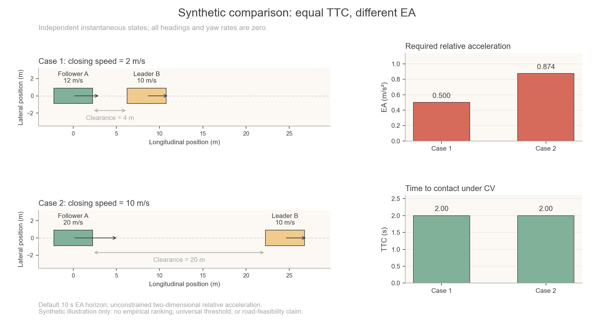

# Recomputable synthetic comparison: equal TTC, different EA

This example constructs two independent instantaneous straight-following
states. They are **synthetic**, not extracted from the paper's datasets, and
are not a reproduction of a paper experiment. It illustrates why the same
time to contact need not imply the same required evasive acceleration.



The preview is generated by the command below, using regular Arial and the
shared Fig. 1 colors. The CSV, not the image labels, is the numerical record.

## Run and inspect

From the repository root:

```bash
python -m pip install -e ".[viz,fast]"
python examples/comparison_case.py --output-dir outputs/comparison_case
```

The example saves four files:

- `comparison_inputs.csv`: the full input states used in this run.
- `comparison_results.csv`: those states plus actual EA, TTC, DRAC, clearance,
  and closing speed, with units in the column names.
- `comparison_case.png`: initial geometry and separate EA/TTC panels.
- `comparison_run.json`: package version, input-file SHA-256, default solver
  settings, assumptions, and the actual resolved plotting font.

The two case rows are independent states, not two consecutive frames. There
is no yaw-rate estimation or use of future observations. Existing output
files are protected by default. Choose a fresh output directory to retain
an earlier run, or explicitly replace generated files with:

```bash
python examples/comparison_case.py --output-dir outputs/comparison_case --overwrite
```

All planned output filenames are checked before computation and writing.
The supplied input file cannot be replaced, even with `--overwrite`.
Strict Arial resolution and full PNG rendering finish before any CSV or
manifest is changed, so font or plotting failures preserve an earlier run.
New targets are created exclusively to prevent accidental replacement.
When replacement is requested, prepared artifacts replace old files one at
a time; this is not a multi-file atomic filesystem transaction.

The script calls the public `compute_ea` API and the existing
`baseline_risk_metrics.compute_real_time_metrics_dict` function. The solver
and the baseline implementations are unchanged. No EA search settings are
relaxed for this demonstration.

## Complete inputs

The machine-readable inputs are in
[`examples/data/comparison_cases.csv`](../examples/data/comparison_cases.csv).
Each road-user tuple below has the order
`(x_m, y_m, speed_m_s, heading_rad, length_m, width_m, yaw_rate_rad_s)`:

| Case | Follower A | Leader B |
|---|---|---|
| 1: lower closing speed | `(0, 0, 12, 0, 4.5, 1.8, 0)` | `(8.5, 0, 10, 0, 4.5, 1.8, 0)` |
| 2: higher closing speed | `(0, 0, 20, 0, 4.5, 1.8, 0)` | `(24.5, 0, 10, 0, 4.5, 1.8, 0)` |

Positions are bounding-box centers in the same Cartesian frame. Both road
users face along positive x, and all yaw rates are supplied as zero. Their
boxes are initially separated, so this example does not exercise the
baseline's special handling of already intersecting bodies.

For these aligned constant-velocity states, the existing baseline reduces to

```text
clearance = x_B - x_A - (length_A + length_B) / 2
closing_speed = speed_A - speed_B
TTC = clearance / closing_speed
```

| Quantity | Case 1 | Case 2 |
|---|---:|---:|
| Initial bumper clearance | 4 m | 20 m |
| Closing speed | 2 m/s | 10 m/s |
| Computed TTC | 2.00 s | 2.00 s |
| Computed EA, approximately | 0.500 m/s² | 0.874 m/s² |
| Computed longitudinal DRAC | 0.500 m/s² | 2.500 m/s² |

Custom input cases must also have equal finite positive TTC values (relative
tolerance `1e-9`, absolute tolerance `1e-12 s`). Both computation and plotting
reject unequal values rather than showing an incorrect equal-TTC title.

These EA values come from the numerical solver, not from the TTC formula or
hand-drawn bars. Recompute the CSV for the values produced by your environment;
the configured numerical tolerance is `0.001 m/s²`.

## What the comparison establishes

TTC describes the same projected contact time in both cases. The closing
speeds and clearances differ, so restoring a collision-free relative motion
can require different acceleration. The default EA solver evaluates all
relative acceleration directions; it is not restricted to longitudinal
braking. In Case 2, its EA is therefore lower than longitudinal DRAC.

The nominal trajectories for CTCT, CTCV, CVCT, and CVCV coincide here because
both yaw rates are zero. The implementation's numerical branches and
approximations can nevertheless produce slightly different mode-specific EA
values. The reported EA uses the existing four-mode arithmetic mean; the
example does not replace it with one branch or require exact equality of
the four numerical outputs.

This does not prove that EA is universally better than TTC, define an
empirical safety threshold, or establish the best response for a real driver.
There are no road boundaries, actuator constraints, friction limits,
interaction-dependent predictions, or perception uncertainty in this example.
EA is a relative-acceleration cost; the figure's arrows show current velocities,
not a recovered control plan. A lane-like reference line is only a geometric
guide, not a constraint on the solver. Safety and road feasibility require
additional evaluation.

## Default numerical settings

The script takes the defaults from the same public state-to-solver interface
used in ordinary single-frame computation. It records them in the run JSON:

| Setting | Default |
|---|---:|
| Future horizon | 10 s |
| Coarse / fine time step | 0.1 / 0.02 s |
| Maximum searched acceleration | 100 m/s² |
| Acceleration tolerance | 0.001 m/s² |
| Coarse directions | 72 |
| Local fine directions | 101 |
| Local fine half-window | 5 degrees |
| Fine refinement ratio | 1.15 |
| Geometry size scale | 1.0 |

## Notebook use

From a source checkout, make the examples directory importable and call the
same computation and plotting functions:

```python
import sys
from pathlib import Path

repo = Path.cwd()  # Set this to the checkout root if your notebook is elsewhere.
sys.path.insert(0, str(repo / "examples"))
from comparison_case import run_comparison, plot_comparison

results = run_comparison(repo / "outputs" / "comparison_case", make_plot=False)
display(results[["case_id", "clearance_m", "closing_speed_m_s", "TTC_s", "EA_m_s2"]])
figure = plot_comparison(results)
display(figure)
```

`plot_comparison` returns the figure without calling `show` or closing it.
Close it with `matplotlib.pyplot.close(figure)` when finished. Matplotlib is
imported only for plotting; `run_comparison(..., make_plot=False)` needs the
batch/Pandas dependency but not the visualization dependency. The plot uses
the shared Fig. 1 palette and strict `figure_style()` (Arial regular, no
bold), and exports PNG only. `run_comparison` also accepts `overwrite=True`
for intentional replacement; its default is `False`. The run JSON records
`font_provenance`, or `null` when plotting is disabled. This publication-style
example requires Arial even if preview font fallback is enabled elsewhere.
