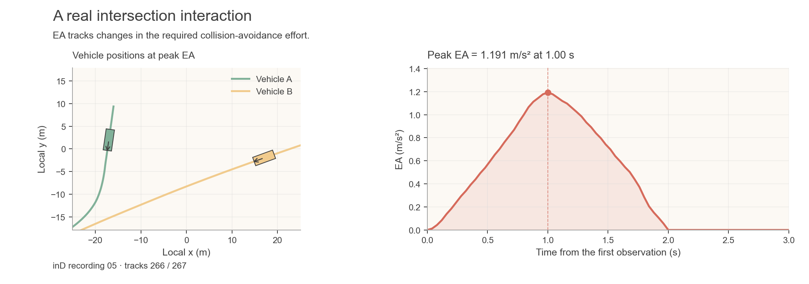
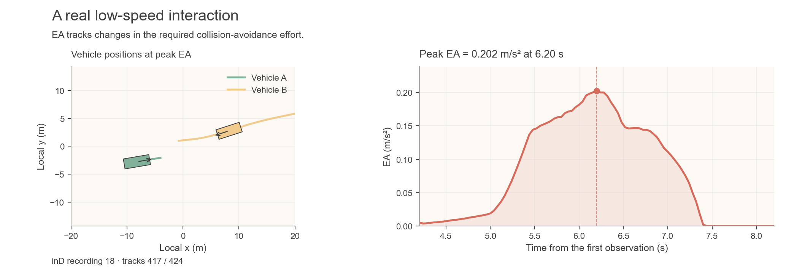

# EA on recorded interactions

These examples use the two real inD interaction excerpts already included in
`demo_data/`. They recompute EA from the recorded states through the public
`compute_ea` API; the figures are not hand-drawn risk curves.

## Intersection interaction



Vehicle A turns while interacting with Vehicle B. EA rises, peaks at about
1.191 m/s², and returns to zero as the projected conflict resolves.
The boxes show the two vehicles at the peak; the lines show their recorded paths
near the interaction. Arrows indicate heading, not an EA control command.

```bash
python examples/real_interaction.py --output-dir outputs/real_interaction
```

Input: [inD recording 05, tracks 266/267](../demo_data/InD_05_tracks_266_267.csv),
195 observations over 7.76 s.

## Low-speed interaction



The second excerpt shows a low-speed vehicle interacting with an approaching
vehicle. Its peak EA is about 0.202 m/s². Together, the cases illustrate EA
histories in different real interactions, rather than defining an alarm threshold.

```bash
python examples/real_interaction.py --case low-speed --output-dir outputs/real_low_speed
```

Input: [inD recording 18, tracks 417/424](../demo_data/InD_18_tracks_417_424.csv),
208 observations over 8.28 s. Use `--case all` to run both in a fresh directory.

## Inspect or reuse the results

Each run saves:

- `<case>_results.csv`: all recorded input columns, elapsed time, and recomputed EA.
- `<case>_ea.png`: vehicle positions and EA history.
- `run.json`: input hashes, numerical settings, EA source provenance and font details.

Every EA value uses only the two states at that timestamp, including their
supplied yaw rates. Later observations provide context in the recorded-path
figure, but are not inputs to an earlier EA calculation. The standard four
CV/CTRV pairings and their arithmetic mean are unchanged.

The figure focuses on a fixed two-second window on either side of the peak
(clipped to the available observations); the CSV retains the complete history.

Use a new output directory for each run. To compute without plotting, add
`--no-plot`. Figure exports use regular Arial and the existing Fig. 1 palette;
see [font setup](figure_style.md) if Arial is not installed.

To adapt your own trajectories, use the [tracking-table example](bring_your_own_data.md).
